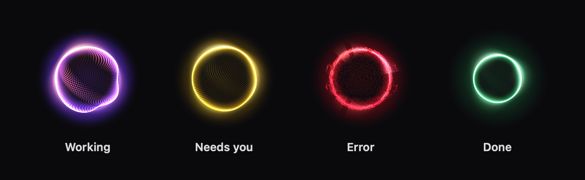
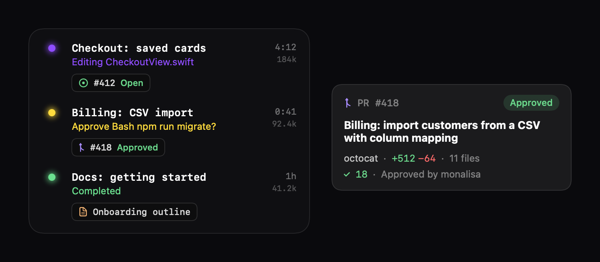

# Claude Bubble

A little orb for your Mac that shows what your [Claude Code](https://claude.com/claude-code) sessions are doing, so
you can look away until one needs you.



- **At a glance.** The orb's colour and motion show the state of your sessions: working (and with which kind of tool),
  waiting on you, failed, or done. One pip per session sits under it.
- **Every session in one list.** Hover the orb for what each session is doing, how long it's been at it, and its
  context size.
- **Pull requests and issues.** Each session shows the GitHub issue and PR it's working on, with live checks and
  review status. Hover a chip for the details.
- **Usage.** Your 5-hour usage and time to reset, with a heads-up before you run low.
- **Stays out of the way.** Float the orb anywhere, or dock it as an island at any screen edge. Quiet mode, "hide for
  an hour", and 15 colour themes are one right-click away.



## Install

You need macOS 14 or later and Claude Code.

1. Download `ClaudeBubble-<version>.zip` from [Releases](../../releases) and unzip it.
2. Move **Claude Bubble.app** to your Applications folder.
3. Open it. The app isn't notarized by Apple, so the first launch needs one extra step:
   - **macOS 15 and later:** open the app and dismiss the warning. Then go to **System Settings → Privacy & Security**,
     scroll down to "Claude Bubble was blocked", and click **Open Anyway**.
   - **macOS 14:** right-click the app, choose **Open**, then click **Open**.
   - **Or, in Terminal:** `xattr -dr com.apple.quarantine "/Applications/Claude Bubble.app"`
4. In the setup window, click **Connect to Claude Code**. Restart any Claude Code sessions that are already running.

### What connecting changes

Connecting adds hooks to `~/.claude/settings.json` that tell the bubble about session events. It also routes your
status line through a small wrapper that saves usage for the bubble and then runs your own status line exactly as
before. Your original settings are backed up to `settings.json.claude-bubble.bak` first. Claude Bubble's own files
live in `~/.claude-bubble`.

### Optional: GitHub status

For live pull request and issue status, install the [GitHub CLI](https://cli.github.com) and sign in:

```sh
brew install gh
gh auth login
```

## Using it

| | |
|---|---|
| Hover the orb | Every session, its status, links and time |
| Click a session | Brings its terminal to the front |
| Right-click the orb | Themes, size, island or orb, quiet mode, hide for an hour, setup |
| Drag the orb | Anywhere, even mostly off the edge of the screen |

## Privacy

Everything stays on your Mac. The bubble reads:

- the session files its hook writes;
- Claude Code's local session state and transcripts, to find issue numbers;
- `git` in your project folders, for branch names.

The only network requests are the GitHub CLI's, made with your own login, and only if you've installed it.

## Uninstall

Right-click the orb, open **Settings… → Disconnect from Claude Code…**, then quit the app and move it to the Trash.
Disconnecting removes only Claude Bubble's hooks and puts your status line back the way it was.

## Build from source

You need Xcode 16 or later.

```sh
git clone https://github.com/BrentWMiller/claude-bubble.git
cd claude-bubble
scripts/bundle.sh      # builds and installs ~/Applications/Claude Bubble.app
swift test             # unit tests
bash Tests/hook_test.sh
```

`scripts/release.sh` builds the universal release zip.

## License

MIT. Claude Bubble is an independent project, not made by or affiliated with Anthropic.
